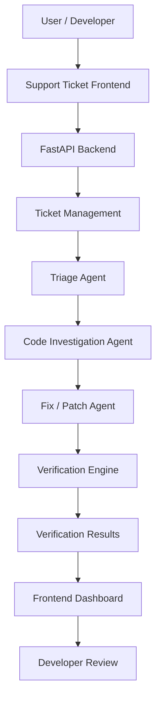

# HalluciNation

# HalluciNation
### From Support Ticket to Verified Fix — Automating the Journey from Bug Report to Resolution

<p align="center">
  <strong>An AI-powered multi-agent software debugging and issue-resolution platform.</strong>
</p>

<p align="center">
  <em>Report it. Investigate it. Fix it. Verify it.</em>
</p>

---

## Overview

**HalluciNation** is an AI-powered software support and debugging platform designed to transform traditional bug reporting into an intelligent, structured issue-resolution workflow.

Instead of simply collecting bug reports and leaving developers to investigate them manually, HalluciNation aims to connect support tickets with specialized AI agents that investigate issues, identify potential causes, generate fixes, and verify proposed solutions.

The platform brings together multiple components into a unified workflow, helping teams move from an unstructured problem description to an actionable and testable resolution.

**Our vision:** Make software debugging more transparent, collaborative, and verifiable through AI-powered automation.

---

## The Problem

Modern software teams receive bug reports through support tickets, GitHub issues, internal communication platforms, and user feedback.

However, resolving these reports often involves several disconnected activities:

- Understanding incomplete or unclear bug descriptions.
- Identifying the affected functionality.
- Locating relevant source code.
- Investigating possible root causes.
- Developing and reviewing fixes.
- Running tests to determine whether a fix actually works.
- Communicating the resolution back to the support team.

These steps consume engineering time and can create delays between reporting a problem and resolving it.

## Our Solution

HalluciNation introduces an integrated AI-assisted workflow that connects support ticket submission with investigation, patch generation, and verification.

The system is designed around specialized components rather than relying on a single general-purpose chatbot.

### Core capabilities

1. **Intelligent Ticket Submission** — Collect bug descriptions, error logs, repository information, branches, and priority levels.
2. **Issue Triage** — Organize incoming reports and prepare them for investigation.
3. **Code Investigation** — Analyze the issue and relevant code to identify possible causes.
4. **Fix Generation** — Produce suggested code changes for developer review.
5. **Verification** — Execute supported checks and report whether the proposed fix passes or fails.
6. **Unified Dashboard** — Present ticket information and investigation results in one interface.

---

## System Architecture



The architecture separates the user interface, backend orchestration, specialized investigation components, and verification responsibilities.

### Agent Responsibilities

| Component | Responsibility |
|---|---|
| Triage Agent | Organizes and prepares submitted issues |
| Code Investigation Agent | Investigates the reported problem and relevant source code |
| Fix / Patch Agent | Generates proposed code modifications |
| Verification Engine | Runs supported checks against proposed changes |
| Backend Coordinator | Connects the ticket workflow and backend services |

*The availability of individual agent capabilities depends on the configured integrations and execution environment.*

---

## Technology Stack

### Frontend
- React
- JavaScript
- Vite
- CSS

### Backend
- Python
- FastAPI
- REST API
- Pydantic

### AI and Agent Integration
- Specialized agent-based workflow
- AI-assisted issue analysis
- Structured investigation and patch generation

### Developer Tools
- Git and GitHub
- Visual Studio Code
- PowerShell
- Docker

### Integration Layer
- Modular backend adapters
- Switch / Mattermost integration interface
- External agent coordination

---

## Application Workflow

### 1. Submit a Support Ticket

Users submit an issue through the web application.

Ticket information includes:

- Issue title
- Issue description
- Error logs (optional)
- GitHub repository
- Branch
- Priority (Low, Medium, High, Critical)

### 2. Issue Triage

The submitted issue enters the backend workflow, where the triage component prepares the issue for further investigation.

### 3. Code Investigation

The investigation component examines the reported problem and relevant code context to identify potential causes.

### 4. Patch Generation

The patch component prepares a suggested solution that developers can inspect before applying it.

### 5. Verification

The verification component executes supported checks to evaluate whether the proposed solution addresses the identified issue.

### 6. Results Dashboard

The frontend presents available ticket information, investigation findings, suggested fixes, and verification results.

---

## Project Structure

```text
HalluciNation/
│
├── Ticket2fix_frontend/
│   └── Ticketwebsitefrontend/
│       ├── src/
│       ├── public/
│       ├── .env.example
│       └── package.json
│
├── person3-backend-integration/
│   └── person3-backend/
│       ├── docs/
│       │   └── switch-integration.md
│       └── ...
│
├── backend/
│   ├── main.py
│   ├── ...
│
├── .gitignore
└── README.md
```

*Update this tree to reflect the final repository structure before publishing.*

---

## Getting Started

### Prerequisites

Install the following:

- Python 3.11 or later (use the version supported by the backend dependencies).
- Node.js and npm.
- Git.
- Docker (if using containerized verification).

### 1. Clone the repository

```bash
git clone https://github.com/Durreshehwar15/HalluciNation.git

cd HalluciNation
```

### 2. Configure the Backend

Navigate to the backend directory:

```powershell
cd backend
```

Create a virtual environment:

```powershell
python -m venv .venv
```

Activate it:

```powershell
.\.venv\Scripts\Activate.ps1
```

Install dependencies:

```powershell
pip install -r requirements.txt
```

Start the backend:

```powershell
uvicorn main:app --reload --host 127.0.0.1 --port 8000
```

Backend documentation:

http://localhost:8000/docs

### 3. Configure the Frontend

Open another terminal:

```powershell
cd Ticket2fix_frontend/Ticketwebsitefrontend
```

Install dependencies:

```powershell
npm install
```

Configure the environment:

Create a `.env` file using `.env.example` as the reference.

```env
VITE_API_URL=http://localhost:8000
```

Start the development server:

```powershell
npm run dev
```

Open:

http://localhost:5173

---

## API Overview

The backend exposes REST endpoints for frontend communication and ticket processing.

| Endpoint | Method | Purpose |
|---|---|---|
| `/health` | GET | Backend health check |
| `/openapi.json` | GET | API schema |
| `/tickets/{ticket_id}/analyze` | POST | Trigger ticket analysis |

Additional endpoints depend on the integrated backend modules.

Explore the interactive API documentation at `/docs`.

---

## Verification and Reliability

HalluciNation emphasizes the importance of checking proposed fixes rather than treating AI-generated code as automatically correct.

The verification workflow is intended to:

- Evaluate proposed code changes.
- Execute supported tests in an isolated environment.
- Capture execution results.
- Distinguish successful checks from failed checks.
- Present evidence for developer review.

**Important:** A generated patch is not equivalent to a verified fix. A successful test run only demonstrates that the executed checks passed; it does not guarantee that every possible issue has been resolved.

---

## Security Considerations

The platform is designed with developer workflow safety in mind.

Recommended deployment safeguards include:

- Keep API keys and credentials in environment variables.
- Never commit `.env` files or private tokens.
- Isolate untrusted repository code during execution.
- Apply execution timeouts and resource limits.
- Review generated patches before applying them.
- Avoid exposing sensitive logs or source code.
- Restrict access to repository credentials.

---

## Current Limitations

HalluciNation is an evolving project.

The following areas require configuration or further development depending on the deployment:

- Production-grade multi-agent orchestration.
- Live Switch / Mattermost transport and credentials.
- Broader programming-language support.
- More comprehensive automated regression testing.
- Advanced repository-wide dependency analysis.
- Production authentication and authorization.
- Deployment and monitoring infrastructure.

---

## Future Roadmap

Our planned improvements include:

- [ ] More advanced root-cause analysis.
- [ ] Deeper GitHub repository integration.
- [ ] Improved multi-agent collaboration.
- [ ] Automated regression-test generation.
- [ ] More robust isolated code execution.
- [ ] Patch confidence and evidence reporting.
- [ ] Switch / Mattermost integration.
- [ ] Continuous integration and deployment support.
- [ ] Support for additional programming languages.

---

## Why HalluciNation?

Traditional bug-reporting platforms help teams record problems.

HalluciNation aims
