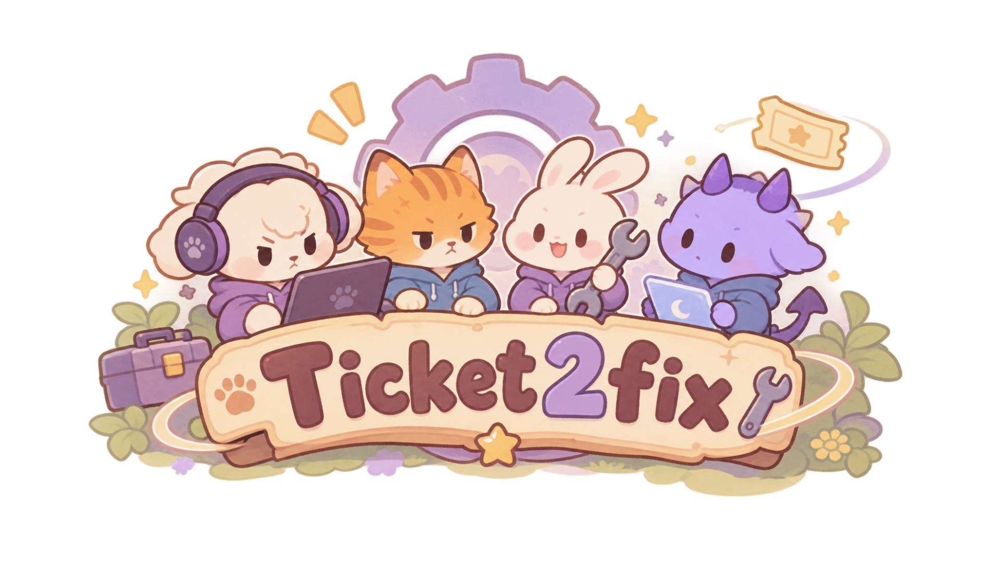
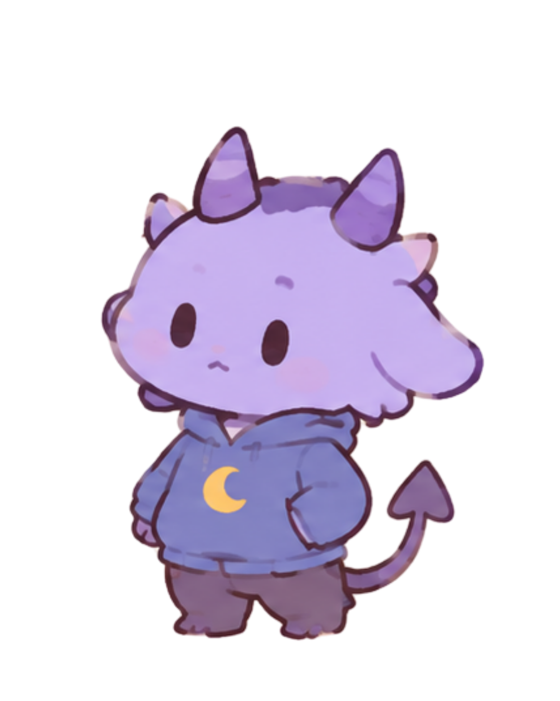
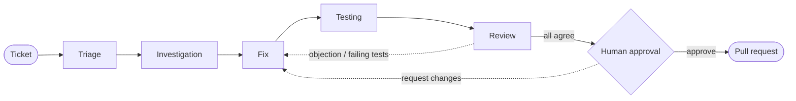

<div align="center">



# HalluciNation
### From Support Ticket to Merged Fix

**A cozy town of AI agents that investigates, fixes and tests your bugs.**
**Agents propose. Humans approve.**

<br/>


<br/>





<br/>

[Demo video](#-demo) · [Features](#-features) · [Meet the team](#-meet-the-agents) · [Run it](#-run-it-locally) · [Status](#-project-status)

</div>

---


---

## The problem

Fixing one bug takes a whole relay race of people: someone reads the ticket, someone digs through the code, someone writes the fix, someone tests it, someone reviews it, and someone finally merges it. Every handoff costs time, and the context gets lost along the way.

## Our idea

**HalluciNation** turns that relay race into a team of specialised AI agents that hand work and evidence to each other, while a **human keeps the final say**.

```
Report a bug  →  Agents investigate  →  Fix is written  →  Tests run  →  Review  →  You approve  →  GitHub handoff
```

We didn't just want code that *looks* right. We wanted a workflow you can **watch, test and trust**:

| Visible | Tested | Controlled |
|---|---|---|
| Every agent message and handoff shows up live in an activity feed, with evidence attached. | Fixes run in an isolated Docker sandbox. Output is evidence, not a guess. | Nothing is merged until a person reviews the diff and presses approve. |

---

## Meet the agents

<table align="center">
<tr>
<td align="center" width="20%"><br/><b>Triage Agent</b><br/><sub>Understands the report, finds the affected feature and opens the investigation task.</sub></td>
<td align="center" width="20%"><br/><b>Code Investigation Agent</b><br/><sub>Reads the code and logs and points to the likely root cause.</sub></td>
<td align="center" width="20%"><br/><b>Fix Agent</b><br/><sub>Writes a patch and explains why it should solve the problem.</sub></td>
<td align="center" width="20%"><br/><b>Testing Agent</b><br/><sub>Runs the tests in a Docker sandbox and reports the evidence.</sub></td>
<td align="center" width="20%"><br/><b>Reviewer Agent</b><br/><sub>Challenges the fix and either approves it or sends it back.</sub></td>
</tr>
</table>

---

## How it works



A ticket moves through these statuses:

`submitted` → `triage` → `investigating` → `fixing` → `testing` → `review` → `awaiting_approval` → `approved` → `pr_created` → `merged`

If the reviewer objects or the human requests changes, the ticket is `rejected` and goes back to the Fix Agent with the feedback.

---

## Features

| | |
|---|---|
| **Easy ticket submission** | Title, description, error logs and up to 3 screenshots. Drag and drop, or paste with Ctrl+V. |
| **Live progress stepper** | See exactly which stage each ticket is in. The page refreshes by itself every 2 seconds. |
| **Agent activity feed** | A timeline of every message and handoff, with evidence: files, logs and test output. |
| **Code diff viewer** | Added and removed lines highlighted, with +/− counts. |
| **Test results panel** | Pass/fail per test, with a tag on newly added regression tests. |
| **Human approval** | Approve and create a PR, or request changes with written feedback. |
| **Interactive town** | Click a character on the home page to report a bug, watch the agents, review a fix or read the guide. |
| **Built-in guide** | Step-by-step help, a status glossary and an FAQ. |
| **Demo mode** | Sample tickets let the whole website run without the backend. |

### Screenshots

<!-- Save your screenshots in docs/images/ with these names. -->
<table>
<tr>
<td align="center"><br/><sub><b>Report a bug</b></sub></td>
<td align="center"><br/><sub><b>Watch the agents work</b></sub></td>
</tr>
<tr>
<td align="center"><br/><sub><b>Review the patch and decide</b></sub></td>
<td align="center"><br/><sub><b>The Ticket2fix town</b></sub></td>
</tr>
</table>

---

## Demo


https://github.com/user-attachments/assets/9d762cd3-c3c3-4da4-a35d-aa584a652c0f


**The story we tell in the demo**

1. A user reports: *"Payment page crashes on invalid coupon."*
2. The Triage Agent identifies the checkout and coupons feature.
3. The Investigation Agent finds that `apply_coupon()` assumes a lookup always returns an object, so an invalid code raises `AttributeError`.
4. The Fix Agent proposes a patch that validates the coupon and raises a friendly `InvalidCouponError`.
5. The Testing Agent runs the suite in Docker and reports the results.
6. The Reviewer Agent checks the fix and the evidence.
7. You review the diff and the tests, then press **Approve & create PR**.

---
## Blog
https://ticket2fix.framer.website/

## Built with

| Layer | Technology |
|---|---|
| **Frontend** | React, Vite, React Router, TanStack React Query, Tailwind CSS |
| **Backend** | Python, FastAPI, SQLite |
| **Test execution** | Docker (isolated sandbox), Pytest |
| **Integrations** | GitHub service, Switch / Mattermost adapter |
| **Art** | Hand-picked mascot illustrations and a themed UI design |

---

## Run it locally

<details>
<summary><b>Prerequisites</b></summary>

- Node.js 18+ and npm
- Python 3.10+
- Docker Desktop (running, for test execution)
- Git

</details>

**1. Clone**

```bash
git clone https://github.com/Durreshehwar15/HalluciNation.git
cd HalluciNation
```

**2. Start the backend**
cd person3-backend-integration/person3-backend

python -m venv .venv
.venv\Scripts\activate
pip install -r backend/requirements.txt

build the test sandbox image (Docker must be running)
docker build -t support-fix-verifier:local demo-repo

the backend does not read .env by itself; set these in this terminal
$env:CORS_ORIGINS = "http://localhost:5173"
$env:HUMAN_APPROVAL_TOKEN = "<a long random string>"
$env:HUMAN_APPROVER_ID = "hackathon-reviewer"
$env:VERIFIER_IMAGE = "support-fix-verifier:local"
$env:MOCK_PATCH_PATH = "demo-repo/app.py"
$env:VERIFIER_PROJECT_DIR = "demo-repo"
$env:DATABASE_URL = "sqlite:///./tickets.db"
# $env:GITHUB_TOKEN = "<fine-grained token>"   # only for pull request creation

uvicorn app.main:app --app-dir backend --host 127.0.0.1 --port 8000

**3. Start the frontend** (in a second terminal)

```bash
cd Ticket2fix_frontend/Ticketwebsitefrontend

npm install
cp .env.example .env            # set VITE_API_URL if the backend isn't on port 8000
npm run dev
```

Open <http://localhost:5173> 

<details>
<summary><b>Environment variables</b></summary>

| Where | Variable | Purpose |
|---|---|---|
| Frontend | `VITE_API_URL` | Backend URL (default `http://127.0.0.1:8000`) |
| Backend | see `backend/.env.example` | GitHub, Docker and Switch settings |

Real `.env` files are never committed. If a secret was ever pushed by accident, rotate it.

</details>

<details>
<summary><b>Run the tests</b></summary>

```bash
cd person3-backend-integration/person3-backend

cd backend && pytest                      # API, demo, Docker and handoff tests
cd .. && python scripts/validate_local_api.py   # check the running API
python scripts/demo.py                    # scripted demo of the workflow
```

</details>

---

## Project structure

<details>
<summary><b>Click to expand</b></summary>

```
HalluciNation/
├── Ticket2fix_frontend/Ticketwebsitefrontend/   # React + Vite app
│   └── src/
│       ├── api/          client.js, mockTicket.js
│       ├── components/   AgentFeed, DiffViewer, PipelineStepper, StatusBadge, TestResults, GameBoard
│       ├── content/      agents.js, assets.js, guide.js
│       ├── hooks/        useTicket.js
│       └── pages/        Home, Guide, Dashboard, SubmitTicket, TicketDetail, Approval
│
└── person3-backend-integration/person3-backend/
    ├── backend/app/      main.py, models.py, schemas.py, routes/tickets.py
    │                     services/ docker_runner.py, github_service.py, switch_adapter.py
    ├── backend/tests/    test_api, test_demo_script, test_docker_live, test_handoff
    ├── demo-repo/        small sample app the agents fix in the demo
    ├── docs/             api-contract.md, integration-guide.md, switch-integration.md
    └── scripts/          demo.py, validate_local_api.py, validate_live_api.py
```

</details>

---

## Switch and Mattermost

Switch is the layer that lets our agents and people work in the same chat room.

1. Installed Switch Console [OS] and Docker.
2. Connected [Codex / agent name].
3. Created the room [name] in [Mattermost].
4. Agents: Triage, Investigation, Fix, Testing, Reviewer. [one line on how each is set up]
5. Handoffs work by [mentions / task assignment].
6. Our backend plugs in through `services/switch_adapter.py`: [what it does now].

Setup details: [`docs/switch-integration.md`](person3-backend-integration/person3-backend/docs/switch-integration.md)
---

## Project status

| Area | Status |
|---|---|
| Frontend: pages, activity feed, diff and test views, approval flow | ✅ Built |
| Backend: ticket API, database, Docker runner, GitHub service | ✅ Built |
| Frontend connected to the live backend | ✅ [confirm] |
| Full ticket-to-fix run through the live backend | ✅ [confirm, add date] |
| Switch Console + [agent] + Mattermost room | ✅ [confirm] |
| Draft pull request creation on GitHub | [✅ tested live on <repo> / 🚧 tested with mocks only] |
## What's next

- [ ] Complete the live ticket → fix run end to end
- [ ] Turn on real Switch and Mattermost messaging
- [ ] Verify the GitHub PR handoff
- [ ] Support more repositories and languages

---

## 👥 Team

<!-- Replace with your team. Add GitHub links if you like. -->
| Name | What they built |
|---|---|
| **Aastha** | _Frontend, UI design and mascots_ |
| **Yiqi** | _Backend and APIs_ |
| **Durre** | _Agents and Switch integration_ |

---

<div align="center">

**Made with lots of coffee, a few bugs of our own, and a lot of fun.** 🐾

*Agents propose. Humans approve.*


</div>
